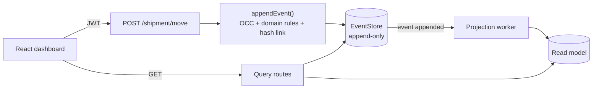

<div align="center">

# 🔐 Audit Trail

### An event-sourced, CQRS shipment ledger where history can't be rewritten

Every change is an immutable, hash-chained event. Current state is *replayed*, never overwritten.
Rewind any shipment to any moment, and prove nothing was tampered with.

[](https://github.com/keshav456mehta/Audit-Trail/actions/workflows/ci.yml)


**[🚀 Live demo](https://audit-trail-red.vercel.app)** · [API health](https://audit-trail-g6zl.onrender.com/health) · [Architecture](docs/ARCHITECTURE.md) · [API reference](docs/API.md)

</div>

> **Try it:** sign in as `viewer` / `YOUR_VIEWER_PASSWORD`, open **`CONT-DEMO-001`**, drag the *Rewind time* slider, and click **Re-verify**.
> The API runs on Render's free tier, so the very first request after a quiet period can take 30–60 seconds to wake up.

---

## 📸 Screenshots

| Dashboard & state | Rewind time | Temperature vs. events |
| :---: | :---: | :---: |
|  |  |  |

---

## 💡 The problem

In a typical CRUD app, updating a container's temperature or location **overwrites** the previous value. In logistics and finance that is unacceptable: when a dispute arises ("when exactly did the cargo get too warm?") the evidence has been destroyed.

Audit Trail stores **every event** instead. The current state of a shipment is computed by replaying its events, so the full, ordered history always exists, and it can be proven intact.

## ✨ Features

| | |
| --- | --- |
| 🧾 **Event sourcing** | Append-only event store; state is a fold over events. |
| ✂️ **CQRS** | Separate write (`POST /shipment/move`) and read (`GET /shipment/…`) routers. |
| ⏪ **Time travel** | `?version=N` / `?asOf=<time>` returns the exact state at that moment. The UI has a *Rewind time* slider. |
| 🔒 **Immutability, in 4 layers** | Immutable schema fields, blocked update/delete/bulk ops, an append-only **database role**, and a hash chain. |
| ⛓️ **Tamper evidence** | SHA-256 hash chain; edits, deletions and re-ordering are detected (`/verify`, `npm run verify:chain`, UI badge). |
| ⚔️ **Optimistic concurrency** | Commands carry `expectedVersion`; stale writes get **409** instead of silently overwriting. |
| 🔁 **Idempotent commands** | Retrying with the same `idempotencyKey` never creates a duplicate event. |
| 📊 **Projections** | A background worker maintains a fast read model; rebuildable from the log at any time. |
| 🌡️ **Sensor analytics** | Recharts temperature series with limit line, spike markers and lifecycle events overlaid. |
| 🛡️ **Auth & roles** | JWT + bcrypt, `viewer` < `operator` < `admin`, rate limits, CORS allow-list, input validation. |

## 🧠 How it works



A shipment's life is a sequence of events:

```
ShipmentCreated → ShipmentPacked → ShipmentShipped → (ShipmentArrivedAtPort) → ShipmentDelivered
                                         └── ShipmentTemperatureRecorded / ShipmentTemperatureSpike (any time before delivery)
```

Illegal moves (skipping a stage, going backwards, acting on a delivered or non-existent shipment) are rejected with **422**.

### Guarantees, and how they're proven

| Guarantee | Mechanism | Verified by |
| --- | --- | --- |
| Nobody silently overwrites someone else's change | `expectedVersion` + unique `{aggregateId, version}` index | 12 parallel writers → exactly **one** wins, the rest get 409 |
| Retries are safe | `idempotencyKey` replay | 5 concurrent retries → exactly one event |
| Events can't be edited or deleted through the app | Immutable fields + every Mongoose mutation blocked | 12 bypass attempts, all rejected, data byte-for-byte unchanged |
| Events can't be edited even with the app's DB credentials | Append-only MongoDB role (`find` + `insert` only) | `node backend/scripts/checkDbRole.js` against the real cluster |
| Tampering is detectable | SHA-256 hash chain (+ read-model cross-check for tail deletions) | Tests edit/delete events directly in the DB and assert detection |

> **Honest limit:** a hash chain proves tampering *happened*; it can't prevent someone with full database admin rights from rewriting everything. For real assurance, keep the append-only role in production and anchor the head hash somewhere you trust. Details in [docs/ARCHITECTURE.md](docs/ARCHITECTURE.md).

## 🧰 Tech stack

**Backend:** Node.js 22 · Express 5 · Mongoose 9 · MongoDB Atlas · JWT · bcrypt · helmet · express-rate-limit
**Frontend:** React 19 · Vite · Tailwind CSS 4 · Recharts · Axios
**Quality:** Node test runner (real database, no mocks) · Vitest + Testing Library · ESLint · GitHub Actions CI

## ⚡ Quick start

**Requirements:** Node 20+ and a MongoDB (local or [Atlas](https://www.mongodb.com/atlas)).

```bash
# 1. Backend
cd backend
npm install
cp .env.example .env        # then set MONGO_URI to your MongoDB connection string
npm run seed                # demo users + 3 demo shipments (idempotent)
npm run dev                 # http://localhost:5000

# 2. Frontend (new terminal)
cd frontend
npm install
cp .env.example .env
npm run dev                 # http://localhost:5173
```

Development demo logins (created by `npm run seed`): `operator` / `operator-pass-123`, plus `viewer` and `admin` with the same pattern.
In production the seed script refuses to create accounts unless you set `SEED_*_PASSWORD` variables.

### Demo shipments

| ID | What to look at |
| --- | --- |
| `CONT-DEMO-001` | Full lifecycle, 11 events, a temperature spike. Best for the rewind slider. |
| `CONT-DEMO-002` | In transit. Record new events and try the 409 conflict (open it in two tabs). |
| `CONT-DEMO-003` | Just created. |

## 🧪 Testing

```bash
npm test                    # from the repo root: backend + frontend
```

| Suite | Count | What it covers |
| --- | --- | --- |
| Backend | 82 | Domain logic; HTTP API against a **real database**: auth/roles, validation, state machine, OCC race, idempotency, immutability bypass attempts, tamper detection, time travel, projections, rebuild |
| Frontend | 36 | Reducer, API client, components, full user flows, and a render test that guards against blank-page crashes |

CI runs both on every push against a real `mongo:7` service.

## 🔌 API at a glance

| Method & path | Role | Purpose |
| --- | --- | --- |
| `POST /auth/login` | – | Get a JWT |
| `POST /shipment/move` | operator | Append an event (needs `expectedVersion`) |
| `GET /shipment/:id` | viewer | State + history. `?version=N` or `?asOf=<ISO>` to time travel |
| `GET /shipment/:id/metrics` | viewer | Temperature series, spikes, lifecycle markers |
| `GET /shipment/:id/verify` | viewer | Verify the hash chain |
| `GET /shipment` | viewer | Paginated list from the read model |
| `GET /stats/shipments` | viewer | Counts per status (aggregation pipeline) |
| `POST /admin/projections/rebuild` | admin | Rebuild the read model from the event log |

Full reference with error codes: [docs/API.md](docs/API.md). A Postman collection lives in `backend/postman/`.

## 🗂️ Project structure

```
backend/
  domain/          pure logic: state machine, fold, time travel, metrics, hash chain
  models/          Mongoose models (EventStore is append-only)
  services/        eventAppender: the single write path
  projections/     read-model worker
  routes/          commands (write) and queries (read), auth, stats, admin
  scripts/         seed, verify-chain, DB-role setup and check
  test/            unit + integration tests
frontend/
  src/components/  Timeline, TimeScrubber, TemperatureChart, CommandPanel, IntegrityBadge, …
  src/hooks/       useAuth, useShipment (+ reducer)
  src/api/         API client
docs/              ARCHITECTURE, API, DEPLOYMENT, original team work log
```

## 🚢 Deployment

Live on **Vercel** (frontend) and **Render** (API) with **MongoDB Atlas**. Step-by-step instructions, environment variables and a production checklist are in [docs/DEPLOYMENT.md](docs/DEPLOYMENT.md). A Docker Compose setup is also included.

## ⚠️ Known limitations

- Each command replays the shipment's event stream. That's fine for hundreds of events per shipment; add snapshots for thousands.
- The read model is eventually consistent (milliseconds). `GET /shipment/:id` always replays the stream and is always exact.
- Rewinding is by event version/timestamp; there's no calendar picker yet.
- Sensor readings are recorded by operators (and the seed script); there's no live device feed.

## 👥 Team

Built by the **Axlero Solutions** internship team: **Keshav**, **Rakesh**, **Praveen**, **Vinay**, **V. Divyesh**.
Process notes from the original build are preserved in [docs/worklog](docs/worklog); see [CHANGELOG.md](CHANGELOG.md) for what changed in v2.

---

<div align="center">
<sub>Event-sourced, CQRS, hash-chained, time-travel-able. 🔐</sub>
</div>
